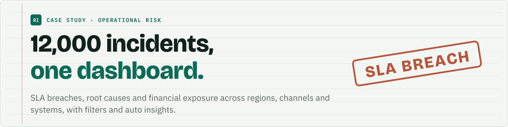
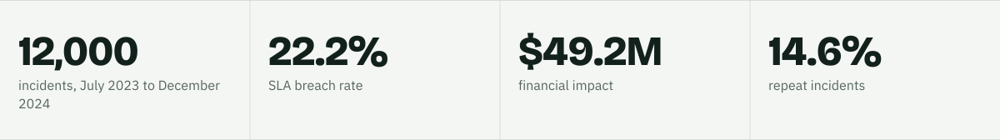
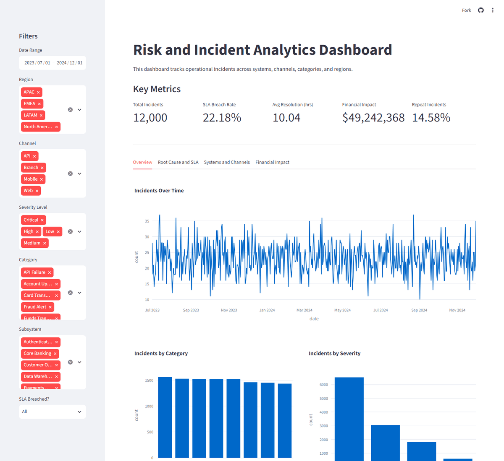
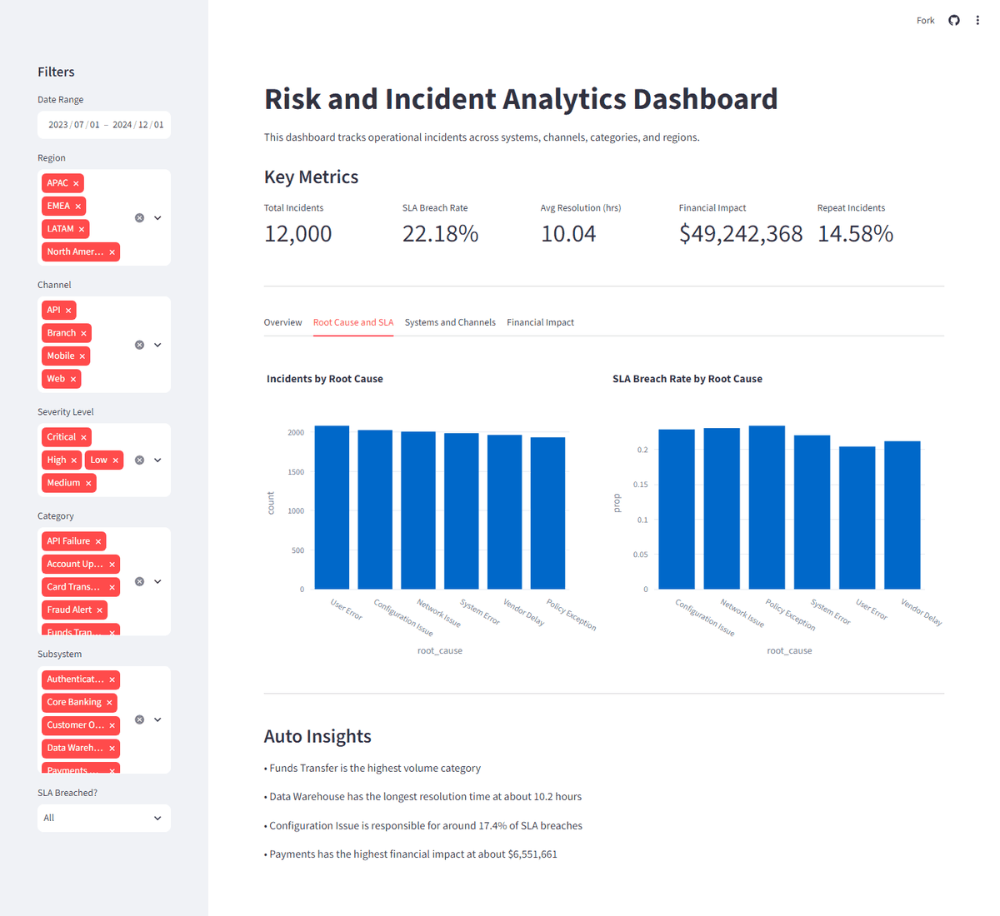
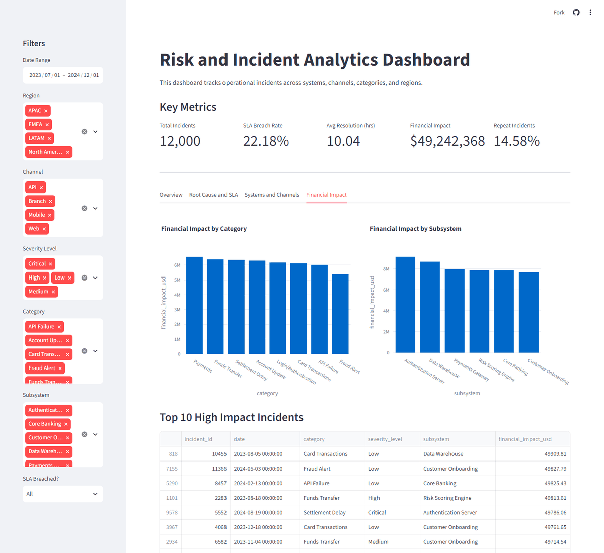

<picture>
  <source media="(prefers-color-scheme: dark)" srcset="assets/banner-dark.svg">
  
</picture>

<p>
<a href="https://portfolio-ebrahimtahirawan-grckguancn6wgnkv2asvvi.streamlit.app/">
<picture>
  <source media="(prefers-color-scheme: dark)" srcset="assets/btn-live-app-dark.svg">
  
</picture>
</a>
&nbsp;
<a href="https://ebrahimtahirr.github.io/ap-agent-site/">
<picture>
  <source media="(prefers-color-scheme: dark)" srcset="assets/btn-ap-case-study-dark.svg">
  
</picture>
</a>
</p>

<sub>Live app: <a href="https://portfolio-ebrahimtahirawan-grckguancn6wgnkv2asvvi.streamlit.app/">https://portfolio-ebrahimtahirawan-grckguancn6wgnkv2asvvi.streamlit.app/</a> (free hosting: if it shows "gone to sleep", click the wake button and give it a minute).</sub>

<picture>
  <source media="(prefers-color-scheme: dark)" srcset="assets/stats-dark.svg">
  
</picture>

## Problem

Operations teams collect thousands of incident tickets but struggle to see where incidents occur, what drives SLA breaches, which systems are unstable and where the money is lost. This dashboard turns a 12,000-row incident log into clear KPIs, root-cause views and a financial exposure summary.

## Approach

- **Data:** `Risk-Ops-Dashboard/data/incidents_12000.csv`, 12,000 synthetic incidents (July 2023 to December 2024) with category, severity, SLA breached, time to resolve, root cause, region, channel, subsystem, repeat flag and financial impact in USD.
- **Exploration:** `notebooks/01_EDA.ipynb`.
- **Dashboard:** Streamlit and Plotly. Filters: date range, region, channel, severity, category, subsystem and SLA breached.
- **Tabs:** Overview (trends, category and severity), Root Cause and SLA, Systems and Channels, Financial Impact (impact by category and subsystem, top 10 costly incidents), plus Auto Insights, plain-text takeaways.
- **Report:** `reports/Operational Incident Analysis.pdf`, a short business case with findings and recommendations.

## Result

| KPI | Value |
|---|---|
| Total incidents | 12,000 |
| SLA breach rate | 22.18% |
| Average resolution time | 10.04 hours |
| Financial impact | $49,242,368 |
| Repeat incidents | 14.58% |

Auto Insights in the live app: Funds Transfer is the highest volume category, Data Warehouse has the longest resolution time at about 10.2 hours, Configuration Issue is responsible for around 17.4% of SLA breaches, and Payments has the highest financial impact at about $6.55 million.

## Stack

Python, Streamlit, Pandas, Plotly.

## Screenshots

<p></p>

<p></p>

<p></p>

## How to run

```bash
pip install -r requirements.txt
streamlit run Risk-Ops-Dashboard/app/app.py
```

Run it from the repo root, because the app reads `Risk-Ops-Dashboard/data/incidents_12000.csv`.
